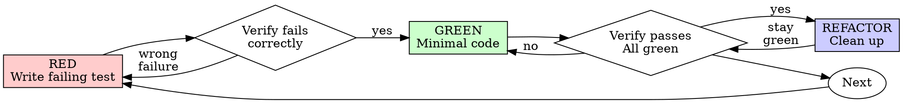

# Test-Driven Development (TDD)

## Overview

Write the test first. Watch it fail. Write minimal code to pass.

**Core principle:** If you didn't watch the test fail, you don't know if it tests the right thing.

**Violating the letter of the rules is violating the spirit of the rules.**

## Choose the proving layer

Prefer a regression-first RED/GREEN cycle for reproducible defects and clear
deterministic behavior changes. The active task and project validation policy
choose the authoritative layer: pure logic tests, Bevy World/App checks, process
or BRP integration, or structured runtime proof as appropriate.

For behavior-preserving refactors, establish characterization coverage, refactor,
and keep it green. For documentation/configuration, run relevant deterministic
checks. Exploration can discover an interface; verify accepted behavior before
claiming production proof. Preserve valid existing implementation when tests were
written later; do not delete it or manufacture a failure solely to satisfy order.

If a new regression passes immediately, investigate whether it covers existing
behavior, misses the defect, or uses the wrong proof layer. For a new deterministic
contract, observe the expected failure before relying on the repair where practical.

## Red-Green-Refactor



### RED - Write Failing Test

Write one minimal test showing what should happen.

<Good>
```typescript
test('retries failed operations 3 times', async () => {
  let attempts = 0;
  const operation = () => {
    attempts++;
    if (attempts < 3) throw new Error('fail');
    return 'success';
  };

  const result = await retryOperation(operation);

  expect(result).toBe('success');
  expect(attempts).toBe(3);
});
```
Clear name, tests real behavior, one thing
</Good>

<Bad>
```typescript
test('retry works', async () => {
  const mock = jest.fn()
    .mockRejectedValueOnce(new Error())
    .mockRejectedValueOnce(new Error())
    .mockResolvedValueOnce('success');
  await retryOperation(mock);
  expect(mock).toHaveBeenCalledTimes(3);
});
```
Vague name, tests mock not code
</Bad>

**Requirements:**
- One behavior
- Clear name
- Real code (no mocks unless unavoidable)

### Verify RED - Watch It Fail

**MANDATORY. Never skip.**

```bash
npm test path/to/test.test.ts
```

Confirm:
- Test fails (not errors)
- Failure message is expected
- Fails because feature missing (not typos)

**Test passes?** Investigate whether it covers existing behavior, misses the defect,
or uses the wrong proof layer. Preserve valid behavior; do not invent a failure.

**Test errors?** Fix error, re-run until it fails correctly.

### GREEN - Minimal Code

Write simplest code to pass the test.

<Good>
```typescript
async function retryOperation<T>(fn: () => Promise<T>): Promise<T> {
  for (let i = 0; i < 3; i++) {
    try {
      return await fn();
    } catch (e) {
      if (i === 2) throw e;
    }
  }
  throw new Error('unreachable');
}
```
Just enough to pass
</Good>

<Bad>
```typescript
async function retryOperation<T>(
  fn: () => Promise<T>,
  options?: {
    maxRetries?: number;
    backoff?: 'linear' | 'exponential';
    onRetry?: (attempt: number) => void;
  }
): Promise<T> {
  // YAGNI
}
```
Over-engineered
</Bad>

Don't add features, refactor other code, or "improve" beyond the test.

### Verify GREEN - Watch It Pass

**MANDATORY.**

```bash
npm test path/to/test.test.ts
```

Confirm:
- Test passes
- Other tests still pass
- Output pristine (no errors, warnings)

**Test fails?** Fix code, not test.

**Other tests fail?** Fix now.

Select affected validation under the task's scope, blast radius, and project
policy. A focused green result does not establish a green suite. Run broader
checks when required by those owners, not as an automatic ritual. Report actual
failures and unrun checks without expanding the implementation to unrelated work.

### REFACTOR - Clean Up

After green only:
- Remove duplication
- Improve names
- Extract helpers

Keep tests green. Don't add behavior.

### Repeat

Next failing test for next feature.

## Good Tests

| Quality | Good | Bad |
|---------|------|-----|
| **Minimal** | One thing. "and" in name? Split it. | `test('validates email and domain and whitespace')` |
| **Clear** | Name describes behavior | `test('test1')` |
| **Shows intent** | Demonstrates desired API | Obscures what code should do |

When writing or changing any test, read [writing-good-tests.md](writing-good-tests.md) for the rules that keep tests honest:
- Name the production change that would make the test fail — before writing it
- Assert on real behavior, never on mock behavior
- Keep test-only code in test utilities, out of production classes
- Understand a dependency's side effects before mocking it

## Review the test contract

- Reproduce the observable defect and choose proof that can detect it.
- Keep assertions on behavior rather than mocks or implementation details.
- Preserve existing valid code and tests while adding missing characterization.
- Do not weaken a test to hide a failure or inflate focused GREEN into full proof.
- Record which checks were run and what remains unavailable or unproven.

## Example: Bug Fix

**Bug:** Empty email accepted

**RED**
```typescript
test('rejects empty email', async () => {
  const result = await submitForm({ email: '' });
  expect(result.error).toBe('Email required');
});
```

**Verify RED**
```bash
$ npm test
FAIL: expected 'Email required', got undefined
```

**GREEN**
```typescript
function submitForm(data: FormData) {
  if (!data.email?.trim()) {
    return { error: 'Email required' };
  }
  // ...
}
```

**Verify GREEN**
```bash
$ npm test
PASS
```

**REFACTOR**
Extract validation for multiple fields if needed.

## Verification Checklist

Before marking work complete:

- [ ] Changed behavior has appropriate proof at its owning layer
- [ ] Observed the expected regression failure where applicable
- [ ] Each test failed for expected reason (feature missing, not typo)
- [ ] Wrote minimal code to pass each test
- [ ] Required affected checks pass; unrun checks are explicit
- [ ] Inspected output, including failures and relevant warnings
- [ ] Tests use real code (mocks only if unavoidable)
- [ ] Edge cases and errors covered

Resolve missing required evidence before claiming the affected behavior is verified.

## When Stuck

| Problem | Solution |
|---------|----------|
| Don't know how to test | Write wished-for API. Write assertion first. Ask your human partner. |
| Test too complicated | Design too complicated. Simplify interface. |
| Must mock everything | Code too coupled. Use dependency injection. |
| Test setup huge | Extract helpers. Still complex? Simplify design. |

## Debugging Integration

For a bug, reproduce it and establish the owning cause with
`superpowers:systematic-debugging`. Add the smallest appropriate regression or
runtime proof, verify the repair, and preserve the limits of that evidence.

## Final Rule

Use meaningful proof for the changed behavior. Keep valid implementation,
regression discipline, and honest evidence states together.
